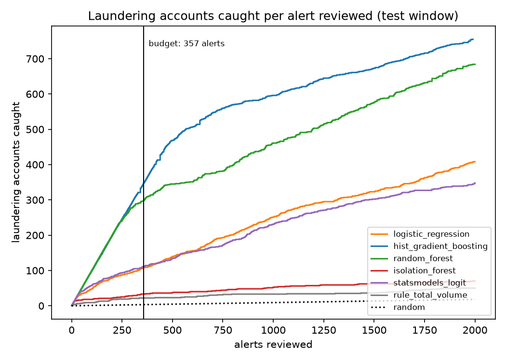
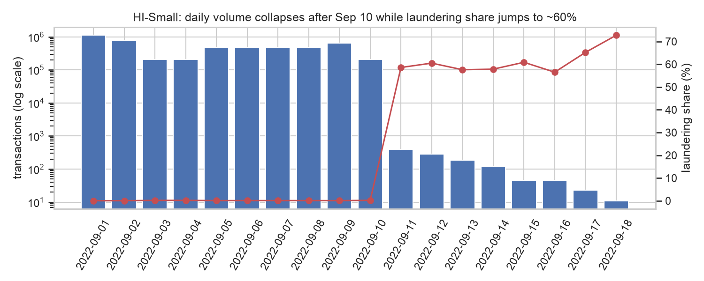
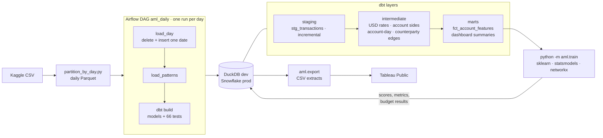
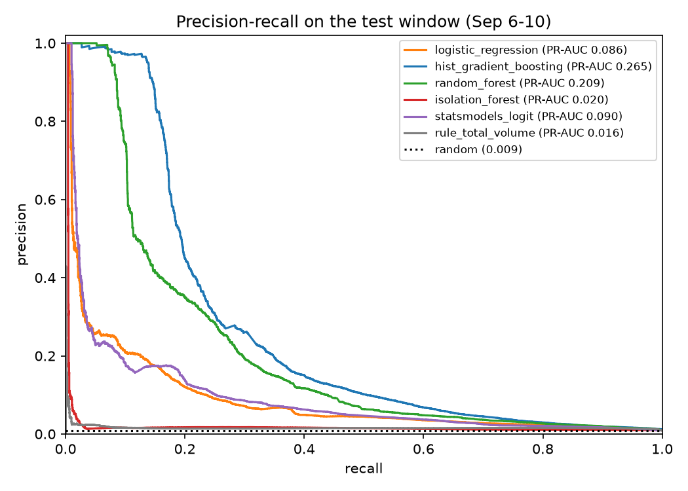

# AML transaction monitoring

An end-to-end anti-money-laundering pipeline on 5 million synthetic bank transfers: daily incremental
loads orchestrated by Airflow, dbt models that turn raw transfers into account-level features, supervised
and unsupervised models that rank suspicious accounts, and an **alert budget analysis** that answers the
question an investigations team actually asks: *with the alerts we can afford to review, how many
launderers do we catch?*

**Headline (test window, Sep 6–10):** with 357 alerts (500 per week), gradient boosting catches
**347 laundering accounts at 97% precision**. Picking accounts at random would catch about 3, and a
"review the biggest accounts" rule catches 22.



## Contents

- [Data](#data)
- [Architecture](#architecture)
- [Design choices](#design-choices)
- [Results](#results)
- [What drives suspicion](#what-drives-suspicion)
- [Limitations](#limitations)
- [How to run](#how-to-run)
- [Repository layout](#repository-layout)

## Data

[IBM Transactions for Anti Money Laundering](https://www.kaggle.com/datasets/ealtman2019/ibm-transactions-for-anti-money-laundering-aml)
(Kaggle), the **HI-Small** variant: 5,078,345 transfers between 515,088 accounts, of which 5,177
transfers (0.10%) are labeled laundering. A companion file attributes 3,209 of them to 370 laundering
attempts across 8 typologies (fan-in, fan-out, cycle, scatter-gather, gather-scatter, stack,
bipartite, random).

Findings from [`notebooks/01_eda.ipynb`](notebooks/01_eda.ipynb) that shaped the design:

- **The last 8 days are a simulation artifact.** Sep 1–10 has 200k–1.1M transfers per day at a
  0.03–0.2% laundering share. Sep 11–18 has ~1,100 transfers in total, ~60% of them laundering:
  attempts still running after normal activity stopped. Modeling uses Sep 1–10 only.
- **Laundering attempts span a median of 3.1 days** (90% within 4.6 days), which set the
  feature window at 5 days.
- The raw header names two columns `Account`, so columns are renamed by position. Account ids are
  only unique within a bank, so the account key is `bank-account`.
- Amounts come in 15 currencies (including Bitcoin). USD rates are derived from the data itself:
  the median implied rate on transfers into US dollars.



## Architecture



- **Partitioning.** The raw CSV is split into one Parquet folder per transaction date. Each row gets
  a deterministic `transaction_id`: an MD5 of all raw fields plus an ordinal that separates the 9
  exact duplicate rows. The id does not depend on file order.
- **Idempotent daily loads.** `load_day.py` deletes the date's rows and inserts the partition in one
  transaction. `stg_transactions` is incremental with `delete+insert` keyed on `transaction_date`,
  so Airflow can rebuild exactly the day it loaded. Re-running any day leaves every table unchanged
  (verified by row count and checksum). Backfilling the DAG replays the whole history.
- **One codebase, two warehouses.** dbt targets switch between DuckDB (`dev`) and Snowflake (`prod`).
  Models use dbt's cross-database macros (`dbt.datediff`, `dbt.dateadd`, `dbt.date_trunc`), so no
  SQL changes between targets.
- **Tests.** 66 dbt tests:
  - `unique` and `not_null` on keys
  - `accepted_values` on payment formats, ISO currency codes and typologies
  - `relationships` from marts and intermediates back to staging
  - custom generic tests: `non_negative` and `unique_combination`
  - two singular tests: same-currency transfers must have paid = received, and every laundering
    transfer must appear as a positive label on both of its accounts

<!-- dbt lineage screenshot: dbt docs generate && dbt docs serve, then save to reports/figures/dbt_lineage.png -->

## Design choices

**One row per account per window.** A monitoring team reviews accounts, not single transfers, and
reviews them for a period. Each row of `fct_account_features` summarizes one account over one 5-day
window. The label is 1 if any of its transfers in that window was laundering. Features include:

- counts and USD totals, means and maxima, sent and received
- distinct counterparties sent to (fan-out) and received from (fan-in)
- cross-bank and cross-currency shares, and the payment-format mix
- burstiness: most transfers in one hour, and mean and minimum gaps between transfers
- pass-through: the out/in ratio and a bounded flow balance
- graph features from networkx: strongly connected component size, round trips, and cycles of
  length 2–4

**Split by time, not at random.** Train on Sep 1–5, test on Sep 6–10. A random split would put an
account's later behavior in training and grade the model on its earlier behavior, which flatters the
score. Gradient boosting hyperparameters are tuned on 20% of the *training* accounts. The test window
is used once.

**PR-AUC, not accuracy.** Under 1% of account-windows are positive, so a model that flags nobody
is more than 99% accurate. Precision-recall AUC measures how well positives are ranked above
negatives, which is what an alert queue needs.

**An alert budget instead of a 0.5 threshold.** A bank does not act on "probability > 0.5". It works
an alert queue sized to its team. Assuming 500 alerts per week, the 5-day window gets 357 alerts.
`aml.alert_budget` computes precision and recall at every score threshold and picks the lowest
threshold whose alert count fits the budget. Ties at the boundary are handled so the budget is never
exceeded. That number of laundering accounts caught is the headline metric.

## Results

Test window Sep 6–10: 372,954 account-windows, 3,357 positive (0.90%). From
[`reports/metrics.json`](reports/metrics.json):

| Model | PR-AUC | Caught at 357 alerts | Precision at budget | Lift over random |
|---|---:|---:|---:|---:|
| HistGradientBoosting (tuned) | **0.265** | **347** | **97%** | **108×** |
| Random forest | 0.209 | 299 | 84% | 93× |
| statsmodels logit | 0.090 | 111 | 31% | 35× |
| Logistic regression (balanced) | 0.086 | 108 | 30% | 34× |
| Isolation Forest (no labels) | 0.020 | 33 | 9% | 10× |
| Rule: highest total volume | 0.016 | 22 | 6% | 7× |
| Random | 0.009 | 3.2 | 0.9% | 1× |



- **Tree ensembles win by a wide margin.** Suspicion depends on combinations: a small account, mostly
  ACH, cross-bank, passing money through. A linear score cannot express that.
- **Isolation Forest barely helps.** Launderers here are not unusual in general, only in specific
  ways. A model without labels has no way to know which ways matter.
- **Capacity has diminishing returns.** Gradient boosting catches 347 with 357 alerts, but doubling to
  ~700 alerts adds only about 200 more ([`notebooks/03_alert_budget.ipynb`](notebooks/03_alert_budget.ipynb)).
- **Scores rank well but are not calibrated probabilities**
  ([calibration plot](reports/figures/calibration.png)). Class weighting inflates scores, and the
  positive rate rose from 0.55% in train to 0.90% in test. Recalibrate on recent data before reading
  scores as probabilities.

## What drives suspicion

statsmodels logistic regression on standardized features. Odds ratios are per one standard deviation
([`reports/logit_coefficients.csv`](reports/logit_coefficients.csv)):

| Term | Odds ratio | 95% CI |
|---|---:|---|
| log fan-out (distinct recipients) | 2.45 | 2.26–2.65 |
| log fan-in (distinct senders) | 2.31 | 2.16–2.46 |
| log transfers received | 2.20 | 2.00–2.41 |
| share of ACH transfers | 2.11 | 2.01–2.22 |
| share cross-bank | 0.48 | 0.45–0.52 |
| log max transfers in one hour | 0.57 | 0.54–0.60 |
| log transfers sent | 0.66 | 0.61–0.72 |
| in a 2–4 step cycle | 1.31 | 1.22–1.40 |
| round trip (A→B→A) | 0.79 | 0.73–0.84 |

- **Counterparties matter most.** More distinct counterparties, in either direction, is the
  strongest signal: fan-in and fan-out typologies made visible.
- **ACH is the laundering rail.** ACH carries 87% of laundering transfers in this data.
- **Frequency alone is not suspicious.** Holding counterparties fixed, frequent senders and bursty
  accounts look like ordinary businesses, such as payroll or merchants.
- **Cycles raise the odds; simple round trips lower them.** Direct back-and-forth is common between
  ordinary trading partners.

These are associations in synthetic data, not causal effects. Most of the top gradient-boosting
alerts are small accounts with 4–6 transfers, mostly ACH and cross-bank, sending on what they receive:
the profile of intermediary ("mule") accounts. Laundering is typically only a quarter of their
transfers, so the model reads the shape of the activity, not the label.

## Limitations

- **Synthetic data.** Simulated launderers follow a few clean typologies, which makes them easier to
  separate than in a real bank. The pipeline and evaluation carry over; the exact catch rate would not.
- **Two windows.** HI-Small has 10 usable days, so there is one train window and one test window. With
  HI-Medium or HI-Large, rolling windows would give several test periods and a variance estimate.
- **Detection, not prediction.** Features and labels come from the same window: the model flags
  accounts for review after the fact, the way transaction monitoring works. It does not predict
  future laundering.

## How to run

Requires [uv](https://docs.astral.sh/uv/) and Python 3.12. Docker is needed for Airflow.

```bash
make setup                         # uv sync
make data                          # Kaggle download (needs ~/.kaggle/kaggle.json), or put
                                   #   HI-Small_Trans.csv and HI-Small_Patterns.txt in data/raw/
make partition                     # CSV -> data/partitions/transaction_date=*/
make load                          # all days + patterns into data/warehouse/aml.duckdb
make dbt-build                     # dbt models and tests on DuckDB
make train                         # models, metrics, plots, scores -> schema ml and reports/
make export-dashboard              # CSV extracts for Tableau -> data/exports/
make test                          # pytest
```

**Airflow.** Runs locally with docker compose (LocalExecutor + Postgres):

```bash
echo "AIRFLOW_UID=$(id -u)" >> .env
docker compose up -d --build                          # UI: http://localhost:8080 (airflow / airflow)
docker compose exec airflow-scheduler \
    airflow dags backfill aml_daily -s 2022-09-01 -e 2022-09-18
docker compose exec airflow-scheduler airflow dags trigger aml_train
```

Verified locally: a backfill of all 18 days into an empty DuckDB file finishes with 18 successful
runs, about 1–2 minutes per day. The resulting warehouse matches the non-Airflow build table for table
(row counts, id checksums, label counts, feature sums), and re-running a single day leaves it
unchanged. Inside Docker, DuckDB is capped at 2 GB and dbt runs on one thread. DuckDB's default of 80%
of RAM got the task OOM-killed in Docker Desktop's 8 GB VM.

**Snowflake.** Run [`scripts/snowflake_setup.sql`](scripts/snowflake_setup.sql) once, fill in `.env`
from `.env.example`, then:

```bash
uv sync --extra snowflake
uv run python scripts/load_day.py --all --target prod
cd dbt && DBT_PROFILES_DIR=. uv run dbt build --target prod
DBT_TARGET=prod uv run python -m aml.train
```

## Repository layout

```
scripts/           download, daily partitioning, raw loaders, Snowflake setup
airflow/dags/      aml_daily (load + dbt build per day), aml_train
dbt/models/        staging/ intermediate/ marts/
dbt/tests/         custom generic and singular tests
src/aml/           features, graph features, models, evaluation, alert budget, training, export
notebooks/         01 EDA, 02 modeling walkthrough, 03 alert budget
tests/             pytest for scripts and src
reports/           figures, metrics.json, logit coefficients
dashboard/         Tableau build guide
```
